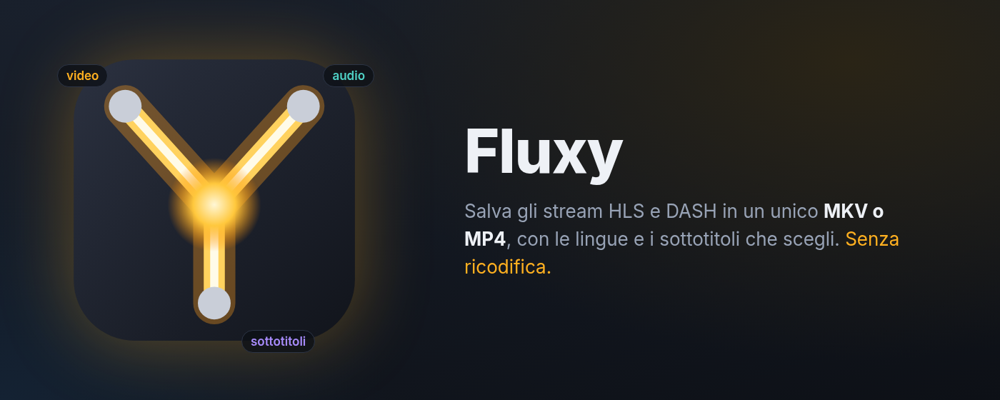
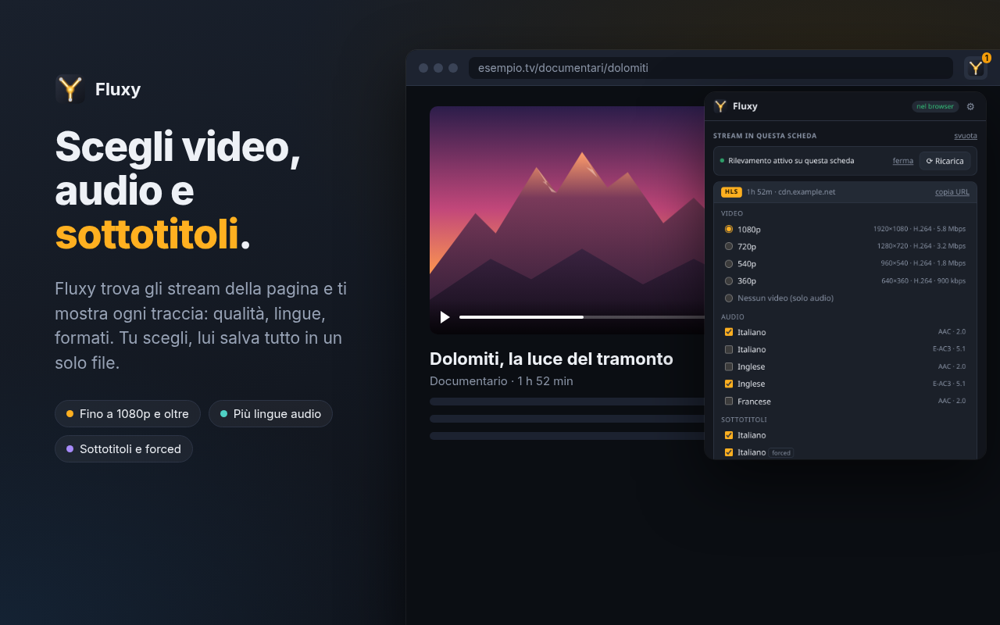

# Fluxy

> Tre flussi, un file.

*[English](README.md)*

Estensione per browser Chromium e Firefox (testata su **Brave Origin 157** e **Firefox 160**) che rileva gli stream
**HLS** e **DASH** caricati dalle pagine, ti fa scegliere qualità video, tracce audio e sottotitoli, e li salva in
**un unico MKV o MP4 senza ricodifica**. Interfaccia in italiano e inglese (segue la lingua del browser).

<p align="center"></p>

<table>
<tr>
<td width="50%"><br><sub>Scegli qualità video, lingue audio e sottotitoli</sub></td>
<td width="50%"><br><sub>Tre flussi, un file — senza ricodifica</sub></td>
</tr>
<tr>
<td width="50%"><br><sub>Rileva, scegli, scarica</sub></td>
<td width="50%"><br><sub>Tutto nel browser, o con l'app locale</sub></td>
</tr>
</table>

## Due motori (⚙ → Motore)

| | **Tutto nel browser** (predefinito) | **App locale** |
|---|---|---|
| Da installare | niente | `fluxy_host.py` + ffmpeg + yt-dlp (pulsante *Installa app locale*) |
| Formati | HLS (anche AES-128, audio "packed" AAC/AC3/E-AC3, `EXT-X-BYTERANGE`) | HLS, DASH, pagine supportate da yt-dlp (YouTube…) |
| Unione | [Mediabunny](https://mediabunny.dev) (MPL-2.0), copia dei pacchetti | `ffmpeg -c copy` |
| Dove salva | cartella Download del browser | cartella a scelta |
| Sottotitoli in MP4 | file `.srt` accanto al video | traccia `mov_text` |

DASH e le pagine yt-dlp usano sempre l'app locale: se non c'è, il popup propone di installarla.

## Versione GitHub e versione store

| | Release GitHub (`chromium`, `firefox`) | Store (`chrome-store`, `firefox-store`) |
|---|---|---|
| YouTube | sì: sulle pagine YouTube il popup propone *Analizza con yt-dlp* (app locale) | no: YouTube viene ignorato (policy del Chrome Web Store) |
| ID Chromium | fisso grazie alla `key` del manifest | assegnato dallo store |

La differenza sta in un solo file generato, `build-flags.js` (`STORE_BUILD`, `DONATE_URL`).

## Lingue

I testi stanno in `tools/messages.py` (per ogni chiave: inglese, italiano); la build scrive
`extension/_locales/{en,it}/messages.json`. Il browser usa la lingua della sua interfaccia e, se manca, l'inglese.
App locale e installer seguono la stessa lingua (l'estensione la comunica all'app; l'installer legge `LANG`).

## Build, release, store

```bash
./build.py                              # DONATE_URL= ./build.py  crea la build senza il link Ko-fi
```

Genera in `dist/` i pacchetti `chromium` (.zip), `firefox` (.xpi), `chrome-store` (.zip) e `firefox-store` (.xpi).
A ogni push su `main` il workflow pubblica la release `vX.Y.Z` se la versione del manifest non ne ha ancora una
(dettagli e firma Firefox nel [README inglese](README.md#releases)). Materiale per gli store: `docs/store/listing.md`,
`docs/PRIVACY.md`, immagini in `docs/store/images/{en,it}/`.

## Installazione

1. Carica l'estensione:
   - **Chromium/Brave**: `brave://extensions` → *Modalità sviluppatore* → *Carica estensione non pacchettizzata* →
     `dist/chromium/` (ID fisso `kipokjinmlcebonicoplnakgedbnlgjo`).
   - **Firefox**: `about:debugging#/runtime/this-firefox` → *Carica componente aggiuntivo temporaneo* →
     `dist/firefox/manifest.json`; per un'installazione permanente serve l'`.xpi` firmato (vedi release).
2. Il motore nel browser non richiede altro.
3. Facoltativo (DASH, YouTube, cartella a scelta): ⚙ → *App locale* → **Installa app locale**, poi nel terminale
   `bash ~/Downloads/fluxy-install.sh` (rimozione: `--uninstall`) e *verifica* nel popup. Dal repository:
   `./host/install.sh`.

Nota Firefox: l'app va registrata in `~/.mozilla/native-messaging-hosts` anche con i profili in `~/.config/mozilla`.

## Rilevamento

**Senza far partire nulla.** Ogni volta che apri il popup, Fluxy legge la scheda attiva (`extension/scanner.js`, in
tutte le cornici, in sola lettura) ed elenca i video salvabili subito: file di `<video>`/`<source>`, link a `.mp4`/
`.webm`, `og:video` e JSON-LD (file diretti, salvati così come sono, a pezzi in parallelo se il server lo permette);
URL `.m3u8`/`.mpd` nella configurazione del player (schede stream come al solito); iframe di YouTube, Vimeo,
Dailymotion, Twitch… (*Analizza con yt-dlp*, app locale). Per i video con player adattivo (`blob:`) o DRM compare
un avviso. Tutto finisce in un'unica lista, *Video in questa pagina*; sfondi animati, anteprime mute in loop e clip
brevissime vanno in *Altri video*, chiusi. I player che creano l'indirizzo del video solo al play si trovano ancora
con *Rileva*.


- **Manuale (predefinito)**: premi *Rileva* sulla scheda; la pagina si ricarica e Fluxy ascolta solo quella scheda
  finché non premi *ferma* o la chiudi.
- **Automatico** (⚙): osserva tutte le schede; comodo, ma sveglia il service worker a ogni richiesta.
- **YouTube** (versione GitHub): niente playlist standard; il popup propone *Analizza con yt-dlp* tramite l'app locale.

## Uso

- **Video**: preselezionata la qualità più alta. **Audio / Sottotitoli**: preselezionate le lingue preferite
  (predefinite: la lingua del browser e l'inglese).
- **Solo sottotitoli**: ogni riga dei sottotitoli ha il link **.srt** che salva solo quella traccia; senza video né
  audio selezionati, *Scarica* salva ogni sottotitolo scelto come `.srt` separato ("Film.it.srt",
  "Film.it.forced.srt"…), con gli orari allineati all'inizio del video.
- **MKV** consigliato. **MP4**: sottotitoli `.srt` accanto al video (motore nel browser) o `mov_text` (app locale).
- Motore nel browser: durante il lavoro serve circa **2× la dimensione del film** su disco (controllato prima di
  iniziare).

## Debug, sistemi, limiti

Vedi le sezioni corrispondenti del [README inglese](README.md#debug). In breve: log dell'app in
`~/.cache/fluxy/host.log`; app locale testata su Linux (macOS da provare, Windows non ancora); niente DRM;
`EXT-X-DISCONTINUITY` non riallineato nel motore nel browser.

## Download: pausa, ripresa, riprova

- **Pausa / riprendi**: nel motore del browser i segmenti già scritti restano e alla ripresa si continua dal primo
  mancante (file diretti: dall'ultimo pezzo da 8 MB); con l'app locale lo strumento in corso (yt-dlp o ffmpeg) viene
  sospeso e ripreso. Non disponibile durante il salvataggio.
- **Riprova** (download falliti o annullati): riparte da quanto già scaricato. I link degli stream hanno spesso token a
  scadenza, quindi prima vengono rinnovati: da un rilevamento più recente della stessa pagina (dopo *Rileva*) o
  rianalizzando la playlist originale. L'app locale riprova anche da sola i sottotitoli, fino a 3 volte.
- **Pagina dei download** (*apri ↗* nel popup): ogni download con qualità video, tracce audio, sottotitoli, motore,
  pagina di origine, destinazione, ora di avvio e tentativi, con le stesse azioni. Nel popup c'è un riepilogo su una
  riga (*1080p · audio IT, EN · sub IT*).
- **Rinomina durante il download** (✎): il nome serve solo al salvataggio, quindi si può cambiare fino ad allora
  (app locale: fino alla fine dell'unione).
- Rimuovendo un download in pausa o fallito si cancellano anche i suoi dati temporanei.

## Licenza

Fluxy è software libero: [GNU GPL v3.0 o successiva](LICENSE), con i [termini aggiuntivi](ADDITIONAL-TERMS.md)
previsti dalla sezione 7:

- va conservata l'attribuzione *"Based on Fluxy by lorisilbagnino"* nel codice e nella riga in fondo alle
  impostazioni;
- le versioni modificate non possono chiamarsi "Fluxy" e devono dichiararsi modificate;
- la licenza non concede diritti su nome e logo di Fluxy.

Mediabunny (`extension/engine/mediabunny.min.mjs`) mantiene la sua licenza, MPL-2.0. I contributi inviati come pull
request sono accettati con la stessa licenza.

## Crediti

Fluxy si basa su [Mediabunny](https://github.com/Vanilagy/mediabunny) (MPL-2.0, incluso); l'app locale facoltativa usa
[FFmpeg](https://ffmpeg.org), [yt-dlp](https://github.com/yt-dlp/yt-dlp), PyCryptodome e Python, installati
dall'utente. Dettagli e licenze: [THIRD-PARTY-NOTICES.md](THIRD-PARTY-NOTICES.md). Ogni pacchetto contiene anche
`LICENSE`, `ADDITIONAL-TERMS.md` e quel file.

## Sostieni Fluxy

Fluxy è gratuito. Se ti è utile puoi sostenerlo con una donazione spontanea:
[**ko-fi.com/lorisilbagnino**](https://ko-fi.com/lorisilbagnino) ☕ (il link è anche nelle impostazioni e nelle schede degli store).
