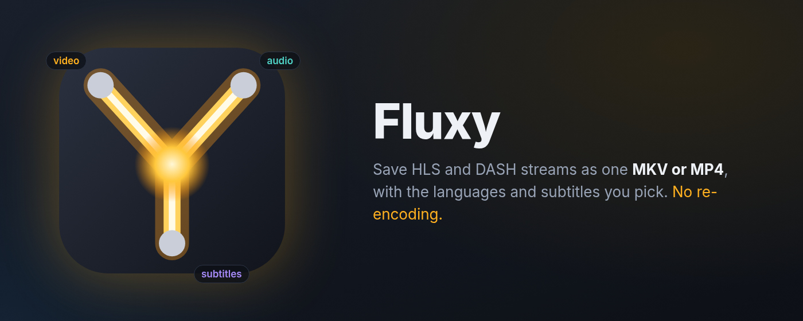
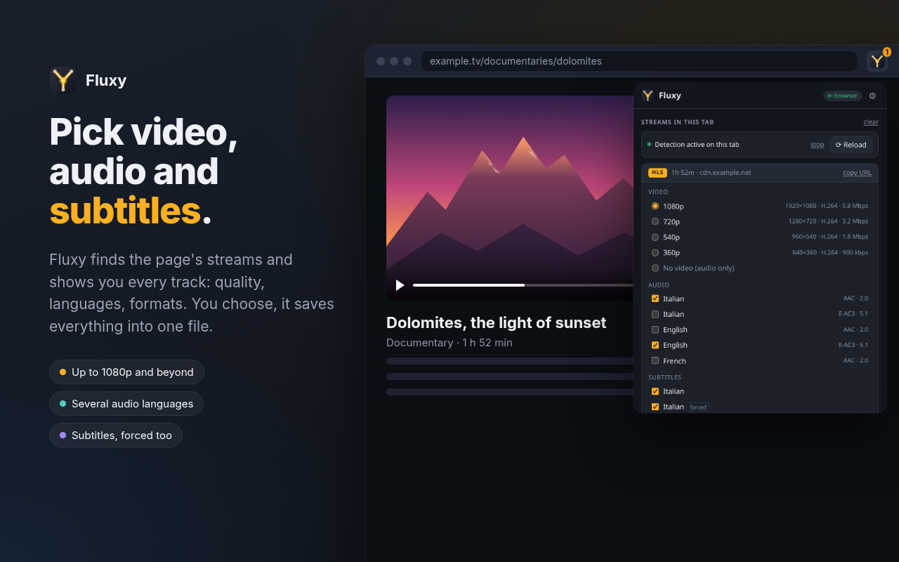
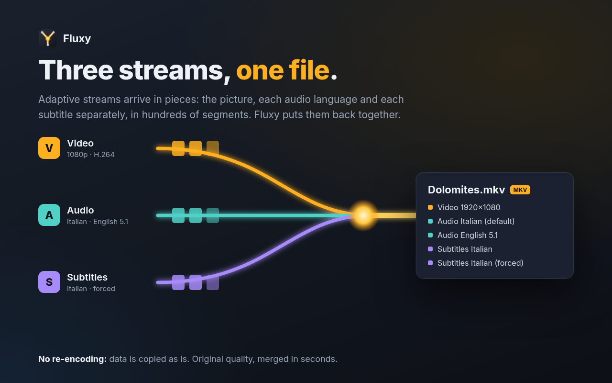
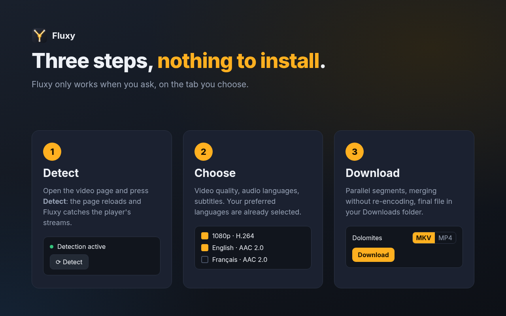
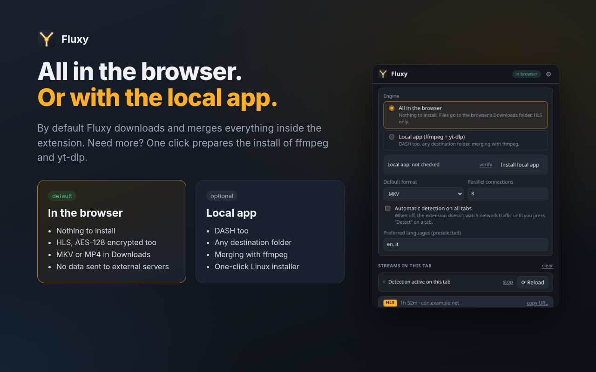

# Fluxy

> Three streams, one file.

*[Italiano](README.it.md)*

Browser extension for Chromium and Firefox (tested on **Brave Origin 157** and **Firefox 160**) that detects the **HLS**
and **DASH** streams loaded by web pages, lets you pick the video quality, audio tracks and subtitles, and saves them
as **one MKV or MP4 without re-encoding**. Interface in English and Italian (it follows the browser's language).

<p align="center"></p>

**Install**: [Chrome Web Store](https://chromewebstore.google.com/detail/ochkddgofckdojefpjcflkmignbmimjn) (Chrome, Edge, Brave…) · [Firefox Add-ons](https://addons.mozilla.org/firefox/addon/fluxy-stream-downloader/) ·
[GitHub releases](https://github.com/lorisilbagnino/fluxy/releases) (with YouTube support via the local app).

<table>
<tr>
<td width="50%"><br><sub>Pick video quality, audio languages and subtitles</sub></td>
<td width="50%"><br><sub>Three streams, one file — no re-encoding</sub></td>
</tr>
<tr>
<td width="50%"><br><sub>Detect, choose, download</sub></td>
<td width="50%"><br><sub>All in the browser, or with the local app</sub></td>
</tr>
</table>

## Two engines (⚙ → Engine)

| | **All in the browser** (default) | **Local app** |
|---|---|---|
| To install | nothing | `fluxy_host.py` + ffmpeg + yt-dlp (*Install local app* button) |
| Formats | HLS (incl. AES-128, "packed" AAC/AC3/E-AC3 audio, `EXT-X-BYTERANGE`) | HLS, DASH, pages supported by yt-dlp (YouTube…) |
| Merging | [Mediabunny](https://mediabunny.dev) (MPL-2.0), packet copy | `ffmpeg -c copy` |
| Saves to | the browser's Downloads folder | a folder of your choice |
| Subtitles in MP4 | `.srt` files next to the video | `mov_text` track |

DASH streams and yt-dlp pages always use the local app: if it's missing, the popup offers to install it.

## GitHub builds and store builds

| | GitHub release (`chromium`, `firefox`) | Stores (`chrome-store`, `firefox-store`) |
|---|---|---|
| YouTube | yes: on YouTube pages the popup offers *Analyse with yt-dlp* (local app) | no: YouTube is ignored (Chrome Web Store policy) |
| Chromium ID | fixed through the manifest `key` | assigned by the store |

The difference is a single generated file, `build-flags.js` (`STORE_BUILD`, `DONATE_URL`).

## Architecture

```
extension/
  background.js   detects .m3u8/.mpd + the page's headers (Referer, Origin, Cookie…), analyses HLS,
                  dispatches downloads to the chosen engine, saves through the downloads API
  engine/         in-browser engine
    hls.js          master/media playlist analysis (same output as fluxy_host.py)
    net.js          fetch with retries and a shared connection limit
    engine.js       segments → OPFS (AES-128 via WebCrypto), WebVTT subtitles, merging with Mediabunny
    runner.js       one job: download → merge → file ready to save; OPFS cleanup
    i18n.js         engine strings (the offscreen document has no chrome.i18n)
  offscreen.*     Chromium: hidden document running runner.js (the service worker may be stopped)
                  Firefox: runner.js runs in the background page, kept awake during downloads
  popup.*         stream choice, download queue, settings, local app installation
  _locales/       en, it (generated from tools/messages.py)
host/
  fluxy_host.py   local app (native messaging, stdlib only): DASH and page analysis (yt-dlp), downloads with
                  yt-dlp, merging with ffmpeg; `fluxy_host.py doctor` tells what's missing and how to install it
  install.sh      registers the app in the browsers and offers to install ffmpeg/yt-dlp (Linux and macOS)
tools/messages.py UI strings (English + Italian)
```

The page's headers (Referer, Origin, Cookie, Authorization) are added to the extension's own requests through
`declarativeNetRequest` session rules, limited to the stream's hosts and removed when the download ends.

## Languages

Texts live in `tools/messages.py` (one entry per key: English, Italian); the build writes
`extension/_locales/{en,it}/messages.json`. The browser picks the language of its own UI and falls back to English.
The local app and the installer follow the same language (the extension passes it to the app; the installer reads
`LANG`). To add a language: add a column to the table and a locale to `write()`.

## Build

```bash
./build.py                              # DONATE_URL= ./build.py  builds without the Ko-fi link
```

| Target | Unpacked | Archive |
|---|---|---|
| Brave, Chrome, Chromium, Edge, Vivaldi… | `dist/chromium/` | `fluxy-<ver>-chromium.zip` |
| Firefox, LibreWolf, Waterfox | `dist/firefox/` | `fluxy-<ver>-firefox.xpi` |
| Chrome Web Store, Edge Add-ons | `dist/chrome-store/` | `fluxy-<ver>-chrome-store.zip` |
| addons.mozilla.org | `dist/firefox-store/` | `fluxy-<ver>-firefox-store.xpi` |

`extension/` is the source (Chromium manifest) and can be loaded directly after running `./build.py` once (it writes
`_locales/` and copies the local app into `extension/native/` for the *Install local app* button).

## Releases

On every push to `main`, `.github/workflows/release.yml` reads `version` from `extension/manifest.json`: if release
`vX.Y.Z` doesn't exist yet, it runs `build.py` and publishes it with the packages, the local app
(`fluxy_host.py`, `install.sh`) and the install instructions from `docs/release-notes.md`. Bump the version to publish
a new release; it can also be started by hand from *Actions → Build e release*.

- Firefox only installs Mozilla-signed packages permanently: with the repository secrets `AMO_JWT_ISSUER` and
  `AMO_JWT_SECRET` (addons.mozilla.org API keys) the workflow signs the `.xpi` as an *unlisted* add-on.
- Chromium doesn't install `.crx` files from outside the Web Store: load the zip in developer mode.
- The repository variable `DONATE_URL` (e.g. the Ko-fi page) is used by the release builds.

## Stores

Listing texts (EN/IT), permission justifications, reviewer notes and checklist: `docs/store/listing.md`.
Privacy policy: `docs/PRIVACY.md`. Images (1280×800 screenshots and promo tiles, English and Italian) in
`docs/store/images/{en,it}/`, rendered from the HTML sources in `docs/store/src/` with `node docs/store/render.mjs`.

## Installation

From the stores: [Chrome Web Store](https://chromewebstore.google.com/detail/ochkddgofckdojefpjcflkmignbmimjn) or [Firefox Add-ons](https://addons.mozilla.org/firefox/addon/fluxy-stream-downloader/). To build and load it yourself:

1. Load the extension:
   - **Chromium/Brave**: `brave://extensions` → *Developer mode* → *Load unpacked* → `dist/chromium/`. The ID is fixed
     (`kipokjinmlcebonicoplnakgedbnlgjo`) by the manifest `key`.
   - **Firefox**: `about:debugging#/runtime/this-firefox` → *Load Temporary Add-on* → `dist/firefox/manifest.json`. It
     stays loaded until Firefox closes: for a permanent install the `.xpi` must be signed by Mozilla (see Releases),
     or use Firefox Developer Edition/Nightly with `xpinstall.signatures.required = false`.
2. Done: the in-browser engine needs nothing else.
3. Optional, for DASH, YouTube or saving with ffmpeg to a folder of your choice: ⚙ → *Local app* →
   **Install local app**. The extension saves `fluxy-install.sh` (the app plus this extension's ID) to Downloads and
   shows the command to run:
   ```bash
   bash ~/Downloads/fluxy-install.sh            # remove: … --uninstall
   ```
   It copies the app to `~/.local/share/fluxy/` (macOS: `~/Library/Application Support/fluxy/`), registers it in the
   browsers it finds and, if ffmpeg/yt-dlp/pycryptodomex are missing, offers the right command for the system
   (pacman, apt, dnf, zypper, apk, nix, brew; pipx/pip if yt-dlp comes from there). Then press *verify* in the popup.
   From the repository you can run `./host/install.sh` directly.

Firefox note: the local app must be registered in `~/.mozilla/native-messaging-hosts` even when profiles live in
`~/.config/mozilla` (checked on Firefox 160). Creating that folder is safe: Firefox picks the profile root by looking
at `~/.mozilla/firefox`.

## Detection: manual or automatic

**Without playing anything.** Every time the popup opens, Fluxy reads the active tab (`extension/scanner.js`, all
frames, read-only) and lists the videos that can be saved right away:

| Found in the page | Result |
|---|---|
| `<video>` / `<source>` files, links to `.mp4`/`.webm`/…, `og:video`, JSON-LD `VideoObject` | direct file: choose the quality, saved as is (parallel ranged download when the server allows it) |
| `.m3u8`/`.mpd` URLs in the player's configuration (inline scripts, `data-*` attributes) | stream card, analysed as usual |
| iframes of YouTube, Vimeo, Dailymotion, Twitch… | *Analyse with yt-dlp* (local app) |
| videos played through MSE (`blob:`) or DRM | a hint: press *Detect* and start the video / protected |

Everything lands in one list, *Videos on this page*: streams first, then the visible, bigger and longer videos, then
embedded players. Background loops, muted autoplay previews and very short or tiny clips are folded into *Other
videos*. A player that builds its video URL only when you press play is still found by *Detect*.

- **Manual (default)**: the extension doesn't watch the network until you press *Detect* on a tab; from then on it
  listens to that tab only (also after navigating) until you press *stop* or close it. The page is reloaded because
  the player has usually fetched its playlist before you open the popup.
- **Automatic** (⚙ → *Automatic detection on all tabs*): watches every tab's requests and analyses each stream right
  away. Handy, but it wakes the service worker on every network request.
- **YouTube** (GitHub build): it exposes no standard playlist; the popup shows *Analyse with yt-dlp*, which hands the
  page to the local app.

If you register the app from the repository with `./host/install.sh` and then move the folder, run the script again
(the host manifest holds the absolute path). To remove: `./host/install.sh --uninstall`.

## Usage

- **Video**: the highest quality is preselected. "audio included" = that variant already carries audio.
- **Audio / Subtitles**: the preferred languages are preselected (⚙ → *Preferred languages*, default: the browser's
  language and English), one audio track per language.
- **Subtitles only**: each subtitle row has an **.srt** link that saves just that track; with no video and no audio
  selected, *Download* saves every selected subtitle as its own `.srt` ("Film.it.srt", "Film.it.forced.srt", …),
  timed from the start of the video.
- **MKV** (recommended) takes everything. **MP4**: subtitles as `.srt` next to the video (in-browser engine) or
  `mov_text` (local app).
- In-browser engine: segments are written to the extension's private storage (OPFS), merged, and the final file is
  handed to the browser's download manager; about **2× the film's size** of disk space is needed meanwhile. The
  extension checks the available space before starting.
- Local app: the file is written to a temporary `.flux-<id>` folder inside the destination and moved at the end.

## Downloads: pause, resume, retry

- **Pause / resume**: in-browser engine, the fetches stop and the segments already written stay in OPFS; resume
  continues from the first missing one (direct files: from the last 8 MB piece). Local app: the running tool (yt-dlp
  or ffmpeg) is suspended (`SIGSTOP`) and resumed. Not available while saving.
- **Retry** (failed or cancelled downloads): continues from what was already downloaded (in-browser: the OPFS data
  kept after the error; local app: the `.flux-<id>` folder, with finished tracks marked `tN.done`). Stream links
  often carry short-lived tokens, so the track URLs are renewed first: from a newer detection of the same page
  (after *Detect*) or by analysing the original playlist again. The local app also retries subtitles 3 times on
  its own.
- **The Fluxy page** (⤢ in the popup header, always there) has three tabs: *Downloads* (every job with video
  quality, each audio track, each subtitle, engine, source page, destination, start time, retries and the same
  actions), *Settings* (the same form as the popup, kept in sync) and *About* (GitHub, releases, issues, license,
  credits, Ko-fi). The popup lists active, paused and failed downloads plus the latest finished ones, each with a
  one-line summary (*1080p · audio IT, EN · sub IT*).
- **Persistent history**: downloads are kept across browser restarts; one left running when the browser closed is
  marked *interrupted* and can be retried. *Clear history* (asks twice) or *remove* a single entry; saved files are
  never touched. The history keeps the latest 300 finished downloads.
- **Queue**: at most *Concurrent downloads* (settings, default 2) run at once; the others wait as *queued* and
  start in order (also after *retry* and *resume*). Each download shows one thin bar per track (video, each audio,
  each subtitle) under its own bar, and an overall bar sums up the active downloads.
- **Progress details**: each download shows its connections (⇉ active/max in the browser engine; max for the local
  app, yt-dlp doesn't report them), MB downloaded / total (*≈* while the total of a stream is estimated), speed, ETA;
  the overall bar sums them up.
- **Speed limit** (settings, and a quick ⏱ selector in the download lists): MB/s for all downloads together. In-browser
  engine: a shared token bucket applied while data arrives, so changes take effect at once; local app: yt-dlp
  `--limit-rate`, split among its running downloads, for the downloads started after the change.
- **Tracks in parallel, skip a track**: video, every audio and every subtitle download at the same time (local app:
  one yt-dlp/ffmpeg process each, the connections split among them). The ✕ on a track's row stops it and leaves it
  out of the file; the rest goes on, and a later retry or resume skips it too.
- **Rename while downloading** (✎): the name is used only when the file is saved, so it can change until then
  (local app: until the merge finishes).
- Removing a paused or failed download deletes its staged data.

## Cast to a TV (local app)

Every stream card has a **Download | Cast** switch. In *Cast* mode you pick the video quality, **one** audio track
and **one** subtitle track (or none), then the TV and the route, and press **Cast to TV**. While a cast is on, the popup
shows the **stream manager** instead of the downloads (play/pause, −10 s / +30 s, position, volume and mute, change of
video/audio/subtitles, stop); the Fluxy page has the same manager in the **Cast** tab, with the list of TVs, "search
again" and "add by address".

| | Chromecast / Google TV | DLNA TV |
|---|---|---|
| Discovery | mDNS (`_googlecast._tcp`, UDP 5353) | SSDP (UDP 1900) |
| Control | Cast v2 (TLS, port 8009), Google's Default Media Receiver | UPnP AVTransport + RenderingControl (SOAP) |
| **Direct** route | the TV loads the original URL (HLS/DASH/file) | the TV loads the original URL (HLS/file) |
| **Through the local app** | HLS: master playlist with the chosen variant, proxied with the page's headers and CORS; files: proxied with Range; DASH/yt-dlp pages: remuxed to fragmented MP4 | everything remuxed by ffmpeg (stream copy) to MPEG-TS; files proxied with Range |
| Audio / subtitles | switched live (tracks of the receiver; subtitles side-loaded as WebVTT) | reload at the current position; subtitles as SRT (Samsung `CaptionInfoEx`) |

- Everything goes through the local app (`fluxy_host.py`, standard library only): Chrome extensions can't load Google's
  Cast SDK (remote code is not allowed in MV3, not even outside the store), and Firefox has no Cast support at all.
- Routes: **automatic** (default) tries the TV on its own first, so nothing has to be opened on this PC; then the same
  TV under its other protocol (AirScreen and similar apps are both a Chromecast and a DLNA renderer: their players
  differ); only as a last resort the relay. The device that worked becomes the next choice. *Direct* alone is lighter
  but some sites or players refuse it; *through the local app* passes the page's headers, fixes CORS and disguised
  segment names (e.g. MPEG-TS served as `.html`/`.m4s`), and lets you choose the tracks on every TV. With remuxed
  streams a seek restarts ffmpeg from the new position. **↻** casts again at once from the current position.
- **Firewall**: discovery uses UDP 5353 and 1900; with the relay the TV connects to this PC on **TCP 8790**
  (`FLUXY_RELAY_PORT` to change it). If no TV shows up, add it by address (Chromecast IP, or the DLNA description URL).
- Store builds cast everything except YouTube; the GitHub builds also cast YouTube and the other yt-dlp sites.
- Not supported: Miracast (screen mirroring of the operating system, not reachable from an app), AirPlay, and apps with
  undocumented protocols (e.g. Web Video Caster). Fire TV works through a DLNA renderer app.

### Don't overload the sites

Some providers block the IP address, sometimes for days, when they receive too many requests at once. The settings
warn when concurrent downloads × connections go above 16, and the download list warns when two downloads from the same
site run together. When a server answers *429 Too Many Requests* or *503*, the in-browser engine halves that download's
connections and waits longer before retrying (honouring `Retry-After`); the local app makes yt-dlp wait between retries.

## Debug

- Analysis from a terminal: `./host/fluxy_host.py probe "<url.m3u8>" "Referer: https://…"`
- Local app log: `~/.cache/fluxy/host.log` (cookies and Authorization redacted)
- Popup as a normal page: `chrome-extension://kipokjinmlcebonicoplnakgedbnlgjo/popup.html?tab=<tabId>`
- Service worker console: `brave://extensions` → Fluxy → *service worker*; in-browser engine: *offscreen.html* on the
  same page. Firefox: `about:debugging` → *Inspect*.

## Supported systems

- **In-browser engine**: wherever the browser runs (Linux, macOS, Windows).
- **Local app**: Linux supported and tested (CachyOS, Brave Origin and Firefox); the installer has the macOS paths,
  not tested yet. Windows: not yet (registry, `.bat` wrapper, `explorer` for "open folder").

## Known limits

- DRM-protected content (Widevine/PlayReady/FairPlay, SAMPLE-AES) is recognised and **not** downloaded. Standard HLS
  AES-128 is supported by both engines.
- In-browser engine: streams with timestamp jumps (`EXT-X-DISCONTINUITY`, typical of inserted ads) are not realigned;
  no DASH (use the local app).
- HLS audio playlists don't declare a bitrate: progress estimates are approximate.
- For DASH and YouTube, yt-dlp groups subtitles by language: two tracks with the same language can't be told apart.
- URLs with expiring tokens should be downloaded soon after detection (reload the page if they expire).

## License

Fluxy is free software: [GNU GPL v3.0 or later](LICENSE), with the [additional terms](ADDITIONAL-TERMS.md) allowed by
section 7:

- keep the attribution *"Based on Fluxy by lorisilbagnino"* in the code and in the line at the bottom of the
  settings panel;
- modified versions can't be called "Fluxy" and must say they are a modified version;
- the license grants no rights to the Fluxy name and logo.

Mediabunny (`extension/engine/mediabunny.min.mjs`) keeps its own license, MPL-2.0. Contributions sent as pull requests
are accepted under the same license.

## Credits

Fluxy builds on [Mediabunny](https://github.com/Vanilagy/mediabunny) (MPL-2.0, included); the optional local app uses
[FFmpeg](https://ffmpeg.org), [yt-dlp](https://github.com/yt-dlp/yt-dlp), PyCryptodome and Python, installed by the
user. Details and licenses: [THIRD-PARTY-NOTICES.md](THIRD-PARTY-NOTICES.md). Every package also contains `LICENSE`,
`ADDITIONAL-TERMS.md` and that file.

## Support

Fluxy is free. If it's useful to you, you can support it with a spontaneous donation:
[**ko-fi.com/lorisilbagnino**](https://ko-fi.com/lorisilbagnino) ☕ (also linked in the settings panel and on the store pages).
